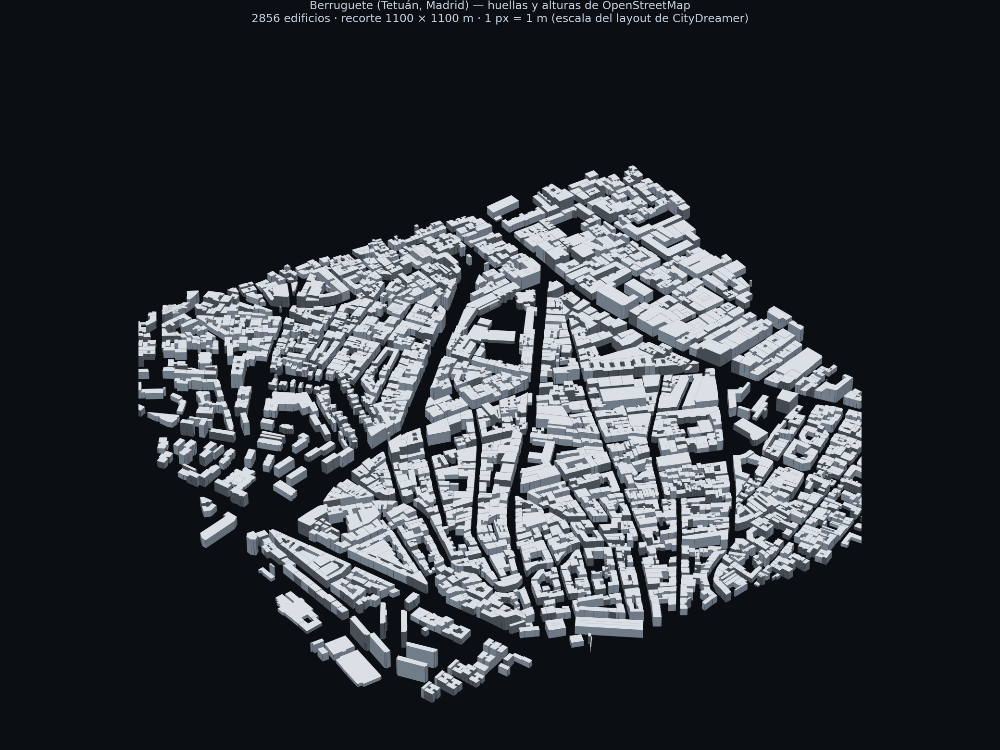

# Berruguete × CityDreamer

Plano real del barrio de **Berruguete (Tetuán, Madrid)** preparado para
[CityDreamer](https://github.com/hzxie/CityDreamer) — el generador de ciudades 3D
infinitas del S-Lab (NTU), CVPR 2024 — más los parches y el cuaderno necesarios para
renderizarlo en una GPU gratuita.



## Qué hay aquí

| Ruta | Qué es |
|---|---|
| `layout/hf.png` | height field en metros (uint16), 4.171 × 3.773 px, **1 px = 1 m** |
| `layout/seg.png` | mapa semántico con la paleta de CityDreamer (calle 1, edificio 2, verde 3, obra 4, agua 5, suelo 6) |
| `layout/metadata.json` | resolución, bounds y métricas del rasterizado |
| `layout/ES-Madrid-Berruguete.osm.gz` | extracto OSM de 3,2 × 3,2 km (Overpass) con el que se generó todo |
| `layout/berruguete_3d.png` | vista axonométrica de comprobación (2.856 edificios) |
| `layout/preview_seg.png`, `preview_hf.png` | la ventana central de 1440 px que ve la red |
| `scripts/berruguete_osm_fetch.py` | descarga el extracto (Overpass + `<bounds>`) |
| `scripts/berruguete_layout.py` | rasteriza OSM → `hf.png` + `seg.png` |
| `scripts/render_layout_3d.py` | vista 3D del layout (matplotlib, sin GPU) |
| `patches/inference-osm.patch` | hace que `scripts/inference.py` use el plano de OSM y no exija `sampler.pth` |
| `notebooks/kaggle-citydreamer-berruguete.ipynb` | cuaderno listo para Kaggle (T4 gratis) |
| `docs/citydreamer-berruguete.md` | **el documento bueno**: arquitectura, escalas, límites y decisiones |

## Reproducir el plano

```bash
python scripts/berruguete_osm_fetch.py --lat 40.4589 --lon -3.7049 --size-m 3200 \
    --out data/xml/ES-Madrid-Berruguete.osm
python scripts/berruguete_layout.py --osm data/xml/ES-Madrid-Berruguete.osm \
    --out data/osm/ES-Madrid-Berruguete --zoom 18
python scripts/render_layout_3d.py --osm data/xml/ES-Madrid-Berruguete.osm \
    --out layout/berruguete_3d.png
```

Necesita `numpy`, `opencv-python`, `pillow`, `lxml`, `tqdm` y `matplotlib`. Sin GPU.

## Render generativo (GPU ≥16 GB)

Sigue el cuaderno de `notebooks/`. En corto:

```bash
git clone https://github.com/hzxie/CityDreamer.git && cd CityDreamer
git apply ../patches/inference-osm.patch
# pesos desde HuggingFace (gratis, sin captcha)
curl -L -o output/CityDreamer-Bgnd.pth https://huggingface.co/hzxie/city-dreamer/resolve/main/CityDreamer-Bgnd.pth?download=true
curl -L -o output/CityDreamer-Fgnd.pth https://huggingface.co/hzxie/city-dreamer/resolve/main/CityDreamer-Fgnd.pth?download=true
pip install -r requirements.txt && for e in extensions/*/; do (cd "$e" && pip install .); done
python3 scripts/inference.py --city_osm_dir data/osm/ES-Madrid-Berruguete \
    --patch_height 3 --patch_width 3 --n_frames 8
```

Con un plano de OSM **no hace falta** `sampler.pth` (el generador de layout no se usa).

## Avisos

- Los edificios del render son **inventados** por el GAN: respeta huella y altura, no la
  arquitectura real de cada portal.
- CityDreamer está entrenado con rascacielos; Madrid sale bajo. Es una decisión estética,
  no un fallo (detalle en `docs/`).
- Licencia del modelo original: **NTU S-Lab License 1.0**. Los datos son de
  © colaboradores de OpenStreetMap (ODbL).

Hecho con ❤️ por David Antizar
